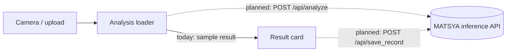

<div align="center">

# MATSYA · Aqua Insight (UI prototype)

### Mobile-first web front end for AI fish species, freshness and size analysis

[](https://react.dev/)
[](https://vitejs.dev/)
[](https://www.typescriptlang.org/)
[](https://ui.shadcn.com/)
[](LICENSE)
[](#status)

</div>

> [!NOTE]
> UI prototype for the [MATSYA](https://github.com/rupeshbharambe24/MATSYA) fish-analysis models,
> generated with Lovable in October 2025. It is **not connected to a backend**: the analysis
> result is a fixed sample (`Labeo rohita`, "Fresh", 22.4 cm, 0.86 kg), and the accuracy and
> dataset figures on the Model Info page (for example 96.5 % validation accuracy, 10,000+ images)
> are placeholder text, not measured results. The real models and evaluation live in the MATSYA repo.

## Overview

MATSYA ("fish" in Sanskrit) aims to let fishers, vendors and researchers photograph a fish and get
its species, freshness grade and estimated length, weight and volume. This repo is the phone-first
web UI for that flow: capture or upload a photo, watch the multi-stage analysis, read the result
card and save it to a personal record history. The result schema it renders (species, freshness,
length, weight, volume, scale mode, per-head confidence) matches the outputs of the MATSYA
pipeline (segmentation → species classifier → freshness classifier → marker-based scale and
length-weight estimation).

### Features

- **Camera capture** via `getUserMedia` (rear camera on mobile) or file upload, with preview and clear
- **Staged analysis loader**: segmentation → species → freshness → weight & volume
- **Result card**: species, freshness, length (cm), weight (kg), volume (cm³), scale mode and confidence scores, with a save action
- **Records page** with totals, species count and average confidence (empty state until saving is wired up)
- **Species database** gallery with search
- **Model info** and **About** pages, login / register forms
- Bottom navigation bar, ocean-gradient theme, web app manifest and app icons for "add to home screen"

## Routes

| Route | Screen | File |
|-------|--------|------|
| `/` | Home | `src/pages/Home.tsx` |
| `/ai` | Capture / upload and analysis | `src/pages/AI.tsx` |
| `/records` | Saved analysis records | `src/pages/Records.tsx` |
| `/database` | Species gallery with search | `src/pages/Database.tsx` |
| `/info` | Model information | `src/pages/ModelInfo.tsx` |
| `/about` | About MATSYA | `src/pages/About.tsx` |
| `/login` | Login / register | `src/pages/Login.tsx` |

## Planned API (stubbed in code)

The calls are written but commented out; they target `http://localhost:8000` (hard-coded
`API_BASE_URL` constants in `AI.tsx`, `Login.tsx` and `SaveButton.tsx`).

| Method | Endpoint | Used by |
|--------|----------|---------|
| `POST` | `/api/analyze` (multipart `image`) | AI analysis page |
| `POST` | `/api/save_record` | Save button on the result card |
| `POST` | `/auth/login`, `/auth/register` | Login page |



## Status

| Aspect | State |
|--------|-------|
| Screens and navigation | Implemented |
| Analysis, records, auth | Mocked / stubbed, no network calls |
| Model metrics shown in UI | Placeholders |
| Offline | `public/sw.js` exists but is not registered yet |

## Tech stack

| Area | Libraries |
|------|-----------|
| Framework | React 18, TypeScript 5, Vite 5 (SWC), React Router 6 |
| UI | Tailwind CSS, shadcn/ui (Radix), lucide-react |

## Getting started

Prerequisites: Node.js 18+.

```bash
npm install
npm run dev          # http://localhost:8080
npm run build        # production build to dist/
```

## Project structure

```text
matysa-aqua-insight/
├── public/                manifest.json, sw.js, icon-192.png, icon-512.png, favicon.ico, robots.txt
├── src/
│   ├── pages/             Home, AI, Records, Database, ModelInfo, About, Login, NotFound
│   ├── components/
│   │   ├── ImageCapture.tsx     camera / upload
│   │   ├── AnalysisLoader.tsx   staged progress
│   │   ├── ResultCard.tsx
│   │   ├── SaveButton.tsx
│   │   ├── Header.tsx, BottomNav.tsx
│   │   └── ui/                  shadcn/ui primitives
│   ├── hooks/             use-toast, use-mobile
│   └── lib/utils.ts
├── vite.config.ts         dev server :8080, lovable-tagger in dev mode
└── package.json
```

## Related repositories

| Repository | Role |
|------------|------|
| [`MATSYA`](https://github.com/rupeshbharambe24/MATSYA) | Fish ML pipeline: segmentation, species and freshness classifiers, size and weight estimation |
| **`matysa-aqua-insight`** | This repo: web UI prototype |

## License

[MIT](LICENSE) © 2025 Rupesh Bharambe
